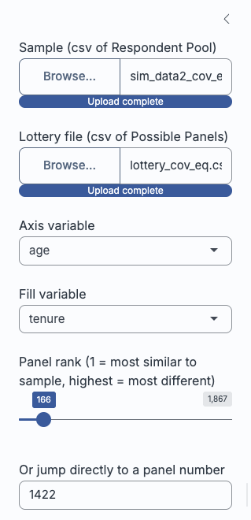
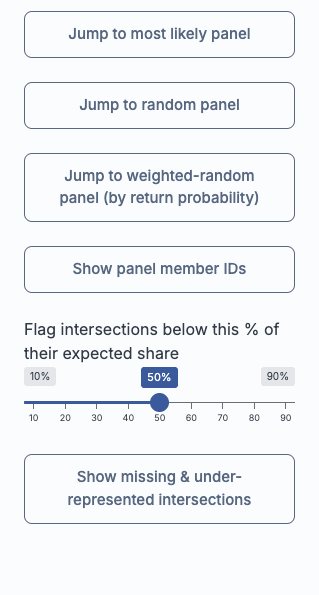

# Introducing Intersection Inspector {#sec-application}

Having flagged the issues with current sortition methods and process, the second gap this thesis set out to address was the absence of a tool for practitioners to assess the viability and intersectionality of panels before deliberation begins. To that end, a Shiny app was developed. Even in current practice, the LexiMin lottery and panel selection process takes two steps: uploading categories, trait quotas and a respondent pool with the desired panel size, then taking the resulting lottery to a separate interactive page for random number generation to select a specific panel. This thesis's app replaces that second step, with added functionality that smooths a practitioner's workflow and gives them more confidence in a panel's representativeness at a controllably granular level of intersectionality -- enabling more informed decisions about quota adjustments and representative validity, and reducing the likelihood of unexpectedly poor intersectional spread when panels convene.

## Context: prior steps in the sortition pipeline

Intersection Inspector is not intended to replace the sortition process as a whole, only its final step. By the time a practitioner opens the app, they are assumed to have already carried out the preceding stages of a sortition: recruiting and surveying a respondent pool, specifying the category variables and trait quotas the panel should satisfy (e.g. minimum and maximum counts per age bracket, per tenure category), and running a selection algorithm over that pool to discover every panel of the desired size that satisfies those quotas. In current practice this selection step is performed by LexiMin, through the Panelot app hosted at [Panelot.org](https://panelot.org), which outputs a lottery file enumerating each feasible panel together with its probability of being returned.

The app takes this lottery file and the underlying respondent pool as given, and does not re-run or second-guess the algorithm that produced them. Its usefulness is therefore not tied to LexiMin specifically: any sortition algorithm or process producing an equivalent output -- a set of feasible panels (or a single panel) drawn from a known respondent pool, satisfying some quota specification -- could be inspected through the app the same way. The quota-based selection step and the intersectional evaluation step addressed here are conceptually separate, and the latter is agnostic to which algorithm performed the former.

## Intended workflow

The app page consists of three parts: 1. a sidebar comprised of interactable buttons, toggles and sliders, 2. a window that displays mosaic plots comparing the 2-way intersections and associations present between the sample and any selected panel for any two selected category variables, and 3. a window that displays the relative proportions of every trait present in the sample and any selected panel, across all categories present within the sample's dataset. @fig-intersection-inspector-overview shows all three parts together, using the associated population's equal-chance lottery (`lottery_cov_eq.csv`) -- the same example used for @fig-panel-vs-sample-example in @sec-results -- as the uploaded sample and lottery file. To make use of this, a practitioner is expected to follow the below procedure.

{#fig-intersection-inspector-overview width=80% fig-alt="Screenshot of the Intersection Inspector app's main view, with a sidebar of file upload and selection controls on the left, a mosaic plot comparison of the survey sample and panel at top right, and a marginal trait distribution bar chart at bottom right."}

### Uploading files

Intersection Inspector takes two files as input: the sample file the lottery was drawn from (the respondent pool that was invited and agreed to participate) and a lottery file (Panelot's `lottery.csv`, enumerating every panel the sortition algorithm found feasible, each with its member IDs and return probability). From these two files alone, the app reconstructs every selected panel's composition on each category present in the sample and makes its intersectional structure directly inspectable, without the practitioner writing any code or leaving the browser.

### Required file structure {#sec-file-structure}

Because the app is designed to work with any sortition process producing an equivalent output, not just this thesis's own simulation (@sec-application), it does not hard-code column names or category domains. Instead, it expects each uploaded file to follow a general structure -- the same structure Panelot itself produces, and the one this thesis's own simulated data (@sec-methodology) is written out in.

The **sample file** (the respondent pool, or survey sample, a lottery was drawn from) should hold one row per respondent, with:

- an optional ID column, detected case-insensitively by header name (`pool_member_identifier`, `id`, `member_id`, `respondent_id`, or `identifier`); if none of these is found, respondents are instead identified by row number, and lottery member IDs are matched against row position;
- two or more further columns, each treated as a single categorical trait (e.g. age bracket, tenure, gender, region). Values in these columns are coerced to character and sorted alphabetically to form each trait's factor levels, since the app has no way to infer a meaningful domain-specific order (e.g. "18-34" before "35-44") for an arbitrary uploaded variable -- a limitation with consequences for ordinal variables discussed further in @sec-current-limitations.

For example, this thesis's own `sim_data2_cov_eq.csv` begins:

```
"pool_member_identifier","age","tenure"
33,"18-34","Rent"
67,"18-34","Rent"
```

The **lottery file** (Panelot's `lottery.csv`, or equivalent) should hold one row per *possible* panel, with:

- a "return probability of panel" column (if applicable), giving the probability panel $j$ would be returned were the lottery run -- optional for the mosaic plots and association tests, but required for the weighted-random panel button;
- one "panel member 1", "panel member 2", ... column per selected panel member, each holding that member's ID, matched against the sample file's ID column (or row number, if no ID column was detected).

Correspondingly, `lottery_cov_eq.csv` begins:

```
return probability of panel,panel member 1,panel member 2,panel member 3,...
0.000890,4957,4961,4964,4966,5017,...
0.001015,6132,6166,6181,6239,6284,...
```

Every trait column in the sample file, not just the two currently selected for the mosaic plot, appears in the marginal bar chart described below (@fig-intersection-inspector-bars) -- so a practitioner can switch which two variables the mosaic plots compare without re-uploading anything.

### Comparing intersections and marginal proportions

Once the files are uploaded, the practitioner selects any two category variables of interest (e.g. age and tenure) and the app renders a pair of mosaic plots side by side: one for the currently selected panel, one for the sample it was drawn from. These mosaic plots visualise the two-way intersection and association between the chosen variables, so that a practitioner can see at a glance whether the panel's joint distribution of traits resembles the sample's "shape", or whether it is skewed in a way that marginal quota counts alone would not reveal. @fig-intersection-inspector-mosaic shows this comparison for the same most-likely panel examined manually in @fig-panel-vs-sample-example -- the app reproduces that same blocky, uneven age-tenure structure directly, alongside the panel's association test p-value, without requiring any code. Beneath the mosaic plots, a second window displays bar charts of every trait's marginal proportion in the panel against the sample, across every category in the dataset, covering representativeness at the single-variable level as well.

{#fig-intersection-inspector-mosaic width=70% fig-alt="Screenshot of the Intersection Inspector app's mosaic plot comparison view, showing two mosaic plots side by side for the survey sample and the selected panel."}

@fig-intersection-inspector-bars shows the accompanying "Marginal trait distributions" view for the same panel and sample: every age bracket and tenure category side by side, with counts labelled directly on each bar. Where the mosaic plots above expose the panel's distorted *joint* structure, this view confirms the panel's single-variable marginals stay close to the sample's throughout -- precisely the gap between marginal and intersectional representativeness this thesis is concerned with (@sec-pie-chart-problem).

{#fig-intersection-inspector-bars width=70% fig-alt="Screenshot of the Intersection Inspector app's marginal trait distributions view, showing bar charts of age and tenure category proportions for the survey sample and selected panel side by side."}

### Testing and browsing panels

Beyond visual inspection, the app formally tests association preservation for each panel using the tests described in @sec-panel-association-methods, summarising each as a p-value and significance interpretation ("level of difference" from the sample), alongside the panel's size and its probability of selection by the lottery. Panels can be browsed in several ways: sliding across all discovered panels ordered from most to least similar in association to the sample, jumping to a uniformly random panel (for arbitrary evaluation of the algorithm's performance), jumping to a probability-weighted random panel (sidestepping the need for a separate external random number generator once a panel is to be finalised), or entering a specific panel ID directly. A further view lets the practitioner check, at an adjustable representation threshold, which intersections are missing or under-represented in the panel relative to the sample. Once a panel is chosen, its member IDs can be inspected and copied to the clipboard to continue the existing workflow (e.g. contacting selected members). @fig-intersection-inspector-sidebar shows the full set of sidebar controls behind this workflow, from file upload and variable selection down to panel navigation, member ID lookup, and the under-representation threshold slider.

::: {#fig-intersection-inspector-sidebar layout="[[-15,25,-10,25,-15]]"}

{#fig-intersection-inspector-sidebar-top fig-alt="Screenshot of the top half of the Intersection Inspector app's sidebar, showing file upload controls, axis and fill variable dropdowns, a panel-rank slider, and a panel ID entry field."}

{#fig-intersection-inspector-sidebar-bottom fig-alt="Screenshot of the bottom half of the Intersection Inspector app's sidebar, showing random and weighted-random selection buttons, a panel member ID lookup button, and an under-representation threshold slider."}

The sidebar's full set of controls, split top-to-bottom into two columns for readability.
:::

### Replacing the Panelot.org selection step

In current practice, after a lottery file is generated, a practitioner takes it to a second, separate interactive page -- on Panelot.org -- purely to generate a random number and select one specific panel from those enumerated, then manually looks up the member IDs from the output. That step reveals nothing about *which* panel is being selected or how representative it is beyond the quota constraints already satisfied; it is, in effect, a black box that turns a lottery file into a single panel. Intersection Inspector is designed as a drop-in replacement: it accepts the same sample and lottery files, supports the same random (and probability-weighted random) selection as a final action, and returns the same member list a practitioner needs -- while additionally providing the mosaic plots, marginal bar charts, association p-values, and under-representation checks along the way.

### Benefits for new practitioners

This is particularly intended to benefit practitioners who are new to sortition or without a statistics background. Rather than trusting that satisfied quota constraints automatically mean a representative panel, the practitioner is given an interpretable visual and numerical basis for that trust -- or for flagging concern -- before a panel is convened. Because panels can be scrolled through and compared on their association preservation, the app can also be used diagnostically: if every available panel shows a similarly poor association to the sample, that points to the quota constraints themselves needing revision, rather than to any single unlucky draw, and may prompt the practitioner to consider whether additional surveying is needed for a more representative sample. Where a blindspot is genuinely infeasible for sortition to resolve on its own -- an intersection too thin in the respondent pool for any quota-constrained panel to capture, say -- the tool at least makes that limit visible, so the practitioner can weigh up whether a separate process (targeted outreach, or a specialist contribution alongside the panel) is needed to fill the gap. In this way, the app turns a previously invisible step of the sortition pipeline into a transparent, inspectable one, directly in the hands of the people already running it.

## Current limitations {#sec-current-limitations}

The mosaic plots and association tests operate on exactly two category variables at a time, chosen from the sidebar's axis and fill dropdowns (@fig-intersection-inspector-sidebar); a dataset with more trait columns -- age, tenure, gender, and region, say -- cannot have its full joint structure inspected in a single view, so a practitioner steps through pairs of interest instead. This is a genuine constraint relative to the full joint distribution a panel's representativeness ultimately depends on, not a design oversight: a fully faceted view spanning four or more variables would trade interpretability for density, and a practitioner without a statistics background is least likely to benefit from that trade. Restricting the view to two variables at a time instead gives deliberate, granular control over the "traits that matter" for a given engagement, rather than every combinatorial intersection a dataset happens to contain, most of which may be irrelevant to the community context at hand -- at the cost of checking each pair in turn rather than seeing the full picture at once, a trade-off future versions could revisit by letting a practitioner flag priority combinations to surface automatically.

A further limitation stems from how uploaded trait columns are turned into factor levels: as noted above (@sec-file-structure), values are coerced to character and sorted alphabetically, since the app has no way to infer a meaningful domain-specific order for an arbitrary uploaded variable. This is immaterial for a nominal variable (gender, region, tenure), but for an ordinal variable it can produce a level order that does not match the variable's natural progression -- an income bracket column with levels "Under \$20k", "\$20k-\$50k", "\$50k-\$100k", "Over \$100k" would not sort correctly alphabetically, nor would an agreement-scale variable running "Strongly disagree" through "Strongly agree".

This does not affect the app's core purpose: the mosaic plots and association tests operate correctly regardless of level order, since both the panel's and sample's blocks are drawn from the same (mis)ordering and remain directly comparable. What it does affect is a mosaic plot's readability by eye -- an ordinal variable with shuffled levels can look "patchier" or less monotonic than the underlying relationship warrants, since blocks that would otherwise sit adjacent and show a smooth gradient are instead scattered across the axis. A practitioner inspecting such a plot should check whether either selected variable is ordinal and read it with that re-ordering in mind, rather than inferring a lack of structure from a sorting artefact. Addressing this within the app -- letting a practitioner manually specify a level order at upload time -- would require per-column metadata the app's intentionally format-agnostic file structure does not currently collect, and so is left for future refinement.

Taken together, these limitations do not undercut the app's core contribution: Intersection Inspector still closes the central gap this thesis has identified, putting a panel's joint structure in front of a practitioner for the first time rather than leaving it unexamined behind satisfied marginal quotas.

