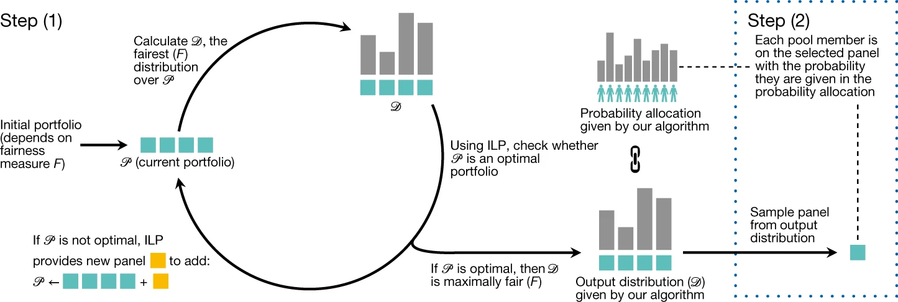
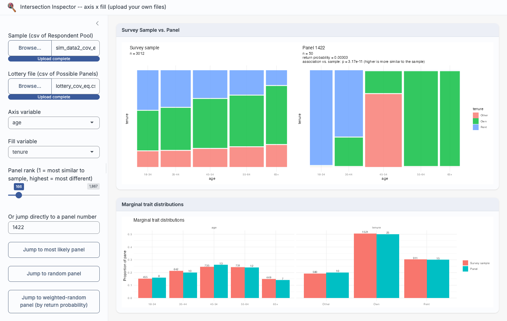

```{r}
#| label: setup
#| include: false

# This file lives in presentation/, but every script and data path
# below is written relative to the thesis project root (one level
# up) -- exactly as the thesis chapters themselves source these
# scripts. Re-pointing knitr's working directory here, rather than
# rewriting every path inside the sourced scripts, keeps this deck
# in sync with the thesis's actual analysis code rather than a copy
# of it.
knitr::opts_knit$set(root.dir = normalizePath(".."))
knitr::opts_chunk$set(root.dir = normalizePath(".."))

library(knitr)
library(ggplot2)
library(dplyr)
library(tidyr)
library(patchwork)
library(ggmosaic2)
options(width = 70)
```

# How did I get into this mess?

## Sortition and representation

- Random selection of individuals to form a deliberative panel
- Used since ancient times, recently gaining renewed interest
- Descriptively representative in theory, enabling greater diversity and inclusion
- Selection is typically handled by a fairness-optimising algorithm (today: **LexiMin**), subject to quotas on each trait category


## The algorithm (LexiMin) {.small-text}



Step (1): construct a maximally fair output distribution $\mathcal{D}$ over an optimal portfolio $\mathcal{P}$ of quota-compliant panels. Step (2): sample the distribution to select a final panel.

**The question this thesis asks:** satisfying quotas on each trait *separately* guarantees fairness of selection chances -- but does it guarantee a panel that actually *looks like* the population, once traits are considered *together*?

## The problem with current visualisations

```{r}
#| label: fig-pie-chart-problem
#| fig-width: 9
#| fig-height: 5.2
#| out-width: 100%
invisible(capture.output(source("scripts/pie_chart_problem.R")))
pie_chart_patchwork
```

Two populations, built to share near-identical age and tenure margins -- yet one has a genuine age-tenure association and the other has none. Pie charts (and bar charts) can't tell them apart.

# So where in the process do we assess representativeness?

## Simulation design

::: {style="font-size: 90%;"}

- Four-stage pipeline: **Population** (n = 100,000) &rarr; **Slice** (10% invited) &rarr; **Sample** (actual respondents) &rarr; **Panel** ($k$ = 50, via LexiMin)
- Two categorical traits: **age** (5 brackets) and **tenure** (Rent/Own/Other)
- Two populations: age & tenure **independent**, or **associated** (negative age-renting relationship, introduced via seeding + raking to preserve identical margins)
- Two response cases: **equal-chance**, or **age-associated** (response probability rises with age)
- &rarr; four simulated respondent pools, each run through Panelot's LexiMin to enumerate every feasible panel

:::

```{r}
#| label: fig-population-slice-sample-panel
#| echo: false
#| fig-width: 9
#| fig-height: 2.6
#| out-width: 100%
box_w <- 1.45
box_h <- 0.6
xs <- c(0, 1.9, 3.8, 5.7)

pipeline_nodes <- data.frame(
  x = xs, y = 0,
  label = c("Population", "Slice\n(invited pool)", "Sample\n(respondent pool)", "Panel\n(k members)")
)
pipeline_edges <- data.frame(
  x = xs[1:3] + box_w / 2, xend = xs[2:4] - box_w / 2, y = 0,
  label = c("random 10% slice", "Bernoulli response\ntrials", "quota-constrained\nselection algorithm")
)

ggplot() +
  geom_rect(data = pipeline_nodes,
    aes(xmin = x - box_w / 2, xmax = x + box_w / 2, ymin = y - box_h / 2, ymax = y + box_h / 2),
    fill = "grey95", colour = "black") +
  geom_text(data = pipeline_nodes, aes(x = x, y = y, label = label),
    fontface = "bold", size = 3.6, lineheight = 0.9) +
  geom_segment(data = pipeline_edges, aes(x = x, xend = xend, y = y, yend = y),
    arrow = arrow(length = unit(0.18, "cm"), type = "closed"), linewidth = 0.4) +
  geom_text(data = pipeline_edges, aes(x = (x + xend) / 2, y = y + 0.4, label = label),
    size = 2.9, lineheight = 0.9) +
  xlim(min(xs) - box_w / 2 - 0.1, max(xs) + box_w / 2 + 0.1) +
  ylim(-0.6, 0.8) +
  coord_fixed(ratio = 1.1) +
  theme_void()
```

## Does the panel preserve the association?

```{r}
#| label: fig-panel-vs-sample-example
#| fig-width: 9
#| fig-height: 4.6
#| out-width: 100%
invisible(capture.output(source("scripts/panel_visualiser.R")))
most_likely_panel_id <- which.max(cov_eq_source$lottery$return_probability)
plot_panel_vs_sample(cov_eq_source, most_likely_panel_id)
```

The sample (left) shows a smooth, gradual age-tenure relationship. The panel (right) satisfies the same marginal quotas, but its joint structure is far more blocky and uneven.

## Even with *no* true association...

```{r}
#| label: fig-panel-vs-sample-independent
#| fig-width: 9
#| fig-height: 4.6
#| out-width: 100%
ind_eq_source <- load_panel_source(file.path(lottery_dir, "lottery_ind_eq.csv"))
most_likely_ind_eq <- which.max(ind_eq_source$lottery$return_probability)
plot_panel_vs_sample(ind_eq_source, most_likely_ind_eq)
```

The independent population's sample is close to flat across age brackets (left) -- yet its panel (right) is, if anything, *more* distorted. There is no real association here for the panel to exaggerate: the distortion is a property of the quota mechanism itself.

## The headline result {.small-text}

```{r}
#| label: tbl-panel-association-summary
#| include: false
invisible(capture.output(source("scripts/performance_evaluator.R")))
file_order <- c("lottery_ind_eq.csv", "lottery_ind_ass.csv", "lottery_cov_eq.csv", "lottery_cov_ass.csv")
display_tbl <- lottery_summary[order(match(lottery_summary$file, file_order)), ]
display_tbl$file <- gsub("^lottery_|\\.csv$", "", display_tbl$file)
```

::: {style="font-size: 75%;"}

```{r}
#| echo: false
knitr::kable(
  display_tbl[, c("file", "n_panels", "sample_cramers_v", "prop_sig_different")],
  col.names = c("Lottery file", "Panels", "Sample V", "Prop. sig. diff."),
  digits = c(0, 0, 3, 3),
  row.names = FALSE
)
```

:::

- Across **all four** simulated conditions (independent/associated population, equal-chance/age-skewed response), **`r round(min(lottery_summary$prop_sig_different) * 100, 1)`-100%** of feasible panels show an age-tenure association significantly different from their own sample
- True even for the **independent** population, where there is no association to distort in the first place
- Against a simple-random-sampling benchmark (500 draws of equal size), panels are flagged at a rate **roughly an order of magnitude higher** than chance

## Why does this happen?

- LexiMin's quotas are set **marginally** -- a count per age bracket, a count per tenure category -- never jointly
- Satisfying every marginal quota says nothing about how those categories *combine* within a selected panel
- A panel can hit every quota count exactly and still be badly skewed on the intersections that matter for lived experience
- This is invisible to the pie charts / bar charts typically used to report panel composition

# Introducing Intersection Inspector

## Demo {background-video="TODO-intersection-inspector-demo.mp4" background-video-loop="false"}

::: {.notes}
Placeholder slide -- swap `background-video` for the recorded screen-capture file (or replace this slide entirely with a `video` shortcode / embedded player) once the Intersection Inspector walkthrough has been recorded. See the Appendix at the end of this deck for the original static-screenshot slides ("What it does", "Comparing intersections", "Testing, browsing, and deciding") to crib talking points from while narrating the demo.
:::

[Video demo of Intersection Inspector -- to be recorded]{style="font-size: 150%;"}

## A framework for practitioners

1. **Quota-based selection** (LexiMin, or future methods) remains the right tool for fair, robust marginal selection probabilities
2. An **intersectional check** -- like Intersection Inspector -- should sit between panel generation and convening, before members are contacted
3. Where a specific intersection matters for an engagement, **deliberate joint-quota constraints or targeted recruitment** are more defensible than trusting marginal quotas to deliver it incidentally

Marginal quota satisfaction should be treated as **necessary, but not sufficient**, evidence of a representative panel.

## Limitations

::: {style="font-size: 90%;"}

- Simulation uses only two categorical variables; real panels typically use three or more -- the gap is expected to compound, not shrink, as dimensionality grows
- Response rates (30-50%) were deliberately elevated above typical civic-lottery rates (often < 10%), to keep cells populated enough to isolate the algorithm's behaviour -- results are a **conservative, best-case** estimate
- Association strengths were fixed at values chosen for visibility, not drawn from a specific real-world dataset
- Intersection Inspector shows two variables' joint structure at a time, and sorts uploaded levels alphabetically (a problem for ordinal variables specifically)

:::

## Future research

- Extend simulation beyond two variables to test how severely distortion scales with added demographic categories
- Revisit with the **Goldilocks** algorithm once released -- does its handling of selection-probability floors/ceilings affect intersectional preservation?
- More directly: selection methods that build in **joint**, intersectional constraints alongside marginal quotas, rather than checking for intersectionality after the fact

## Reproducibility and Software

Code, data and thesis source available at <https://github.com/Pian0Dan/Honours>. Analysis in [R](https://www.r-project.org/) with Quarto, using:

::: {style="font-size: 75%;"}

- tidyr [@R-tidyr] &nbsp; dplyr [@R-dplyr] &nbsp; knitr [@R-knitr] &nbsp; ggplot2 [@R-ggplot2]
- patchwork [@R-patchwork] &nbsp; ggmosaic2 [@R-ggmosaic2] &nbsp; shiny [@R-shiny] &nbsp; kableExtra [@R-kableExtra]

:::

# So... am I in the room?

A fair lottery is not the end of the question. A panel can be perfectly fair by the numbers and still quietly leave an entire slice of a community's lived experience unheard -- simply because no one checked whether the categories were ever meant to be looked at together.

# Appendix: Intersection Inspector (backup slides)

## What it does

A Shiny app that replaces the final, opaque "generate a random panel" step of the sortition pipeline with an inspectable one -- given a lottery file and its respondent pool, it lets a practitioner see, test, and browse panels before one is finalised.



## Comparing intersections

::: {layout-ncol=2}


:::

The gap between these two views **is** the gap this thesis is about: marginal representativeness without intersectional representativeness.

## Testing, browsing, and deciding

{width=55%}

- Formally tests each panel's association against its sample (same tests used in the results above)
- Browse panels by similarity, at random, weighted by return probability, or by ID
- Flags under-represented intersections at a practitioner-adjustable threshold
- Agnostic to the selection algorithm -- works with any lottery file in the same format

## References {style="font-size: 65%;"}