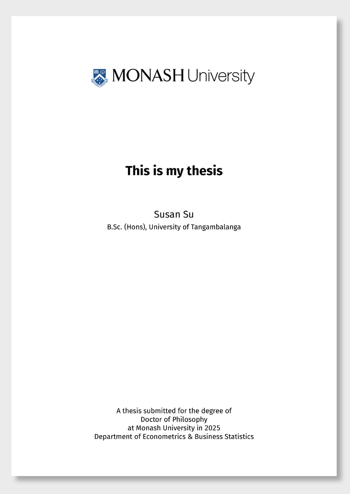

<!-- README.md is generated from README.qmd. Please edit that file -->

```{r}
#| include: false
# Create pdf and png version of template
library(tidyverse)
library(quarto)
library(magick)

# Render template
quarto_render(input = "index.qmd")
# Convert rendered PDF to PNG
image_read_pdf("_book/This-is-my-thesis.pdf", pages = 1) |>
  image_montage(geometry = "x1000+25+35", tile = 1, bg = "grey92", shadow = TRUE) |>
  image_convert(format = "png") |>
  image_write("examples/template.png", )
# Move pdf to examples folder
fs::file_copy("_book/This-is-my-thesis.pdf", "examples/template.pdf", overwrite = TRUE)
```

# Milestone Due Dates

- Milestone 1: Decision on Topic - 27/03
- Milestone 2: Presentation Slides Submitted - End of Week 9 11:55PM
- Milestone 3: Presentation Due - 18-22/05


```bash
quarto use template quarto-monash/thesis
```

This will install the extension and create the files that you can use as a starting place for your thesis.

[](examples/template.pdf)
